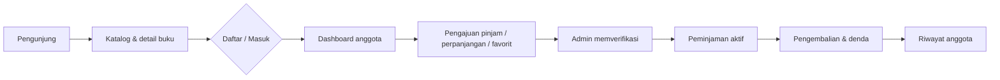

# 📚 Sistem Informasi Perpustakaan Umum

<p align="center">
  <strong>Katalog digital, sirkulasi, dan laporan perpustakaan dalam satu aplikasi web.</strong><br>
  Dibangun dengan PHP native, MySQL, dan Tailwind CSS — tanpa framework.
</p>

<p align="center">
  
  
  
  
  
</p>

<p align="center">
  <a href="https://github.com/AliAlhafidz/KatalogPerpustakaan">Repository</a> ·
  <a href="srs/SRS_Sistem_Informasi_Perpustakaan.pdf">SRS</a> ·
  <a href="uml/UMLAliAlhafidzMulyana.drawio">UML</a>
</p>

> **Sekilas:** 10 tabel · 14 relasi · 3 peran pengguna · katalog publik · pengajuan peminjaman · perpanjangan · denda otomatis · laporan CSV · PWA.

---

## Daftar Isi

- [Tentang Proyek](#tentang-proyek)
- [Fitur Utama](#fitur-utama)
- [Alur Singkat](#alur-singkat)
- [Teknologi](#teknologi)
- [Aturan Sistem](#aturan-sistem)
- [Struktur Proyek](#struktur-proyek)
- [Skema Database](#skema-database)
- [Instalasi](#instalasi)
- [Konfigurasi](#konfigurasi)
- [Akun Demo](#akun-demo)
- [Keamanan](#keamanan)
- [Integrasi ISBN](#integrasi-isbn)
- [PWA](#pwa)
- [Dokumentasi](#dokumentasi)
- [Keterbatasan](#keterbatasan)
- [Lisensi & Kredit](#lisensi--kredit)

## Tentang Proyek

Aplikasi ini dibuat untuk memenuhi **Uji Kompetensi Keahlian (UKK)** dan menjadi contoh sistem perpustakaan yang lengkap: mulai dari katalog yang bisa diakses pengunjung, pendaftaran anggota, pengajuan peminjaman, persetujuan admin, pengembalian, denda, hingga laporan.

Fokus utamanya bukan sekadar CRUD, tetapi **alur sirkulasi yang konsisten**:

- stok berkurang saat peminjaman disetujui;
- pengajuan ganda dicegah oleh aturan database;
- pengembalian mengembalikan stok secara aman;
- riwayat tetap tersimpan walaupun buku dihapus dari katalog;
- notifikasi dibuat otomatis tanpa cron.

## Fitur Utama

### 🌐 Pengunjung — tanpa login

| Fitur | Keterangan |
|---|---|
| Katalog buku | Pencarian judul, penulis, ISBN, dan penerbit |
| Filter & urutan | Kategori, ketersediaan, A–Z, terbaru, stok terbanyak |
| Pagination | 24 buku per halaman |
| Sorotan katalog | “Buku Paling Banyak Dipinjam” (cache 5 menit) dan “Pilihan Minggu Ini” |
| Detail buku | Cover, rak, stok, deskripsi, dan status ketersediaan |
| Favorit | Pengunjung diarahkan login sebagai anggota melalui modal |
| Halaman Tentang | Profil layanan, alur peminjaman, tata tertib, fasilitas, jam buka, dan FAQ |
| Registrasi | Pendaftaran anggota mandiri langsung dari web |

### 👤 Anggota

| Fitur | Keterangan |
|---|---|
| Dashboard | Pinjaman aktif, estimasi denda, notifikasi, pengajuan menunggu, statistik pribadi |
| Peminjaman aktif | Kalender jatuh tempo dan status perpanjangan |
| Riwayat | Tanggal, status, denda; buku yang sudah dihapus tetap tampil sebagai keterangan katalog |
| Favorit | Tambah dan hapus buku favorit |
| Notifikasi | Pengingat H-3, peringatan terlambat, lencana belum dibaca, “tandai semua dibaca” |
| Perpanjangan | Ajukan 1–7 hari, maksimal 1× per transaksi, perlu persetujuan admin |
| Pengajuan pinjam | Status menunggu, disetujui, ditolak, atau dibatalkan |
| Profil | Ubah nama, kontak, alamat, foto, dan password |

### 🛠️ Admin

| Area | Fitur |
|---|---|
| Dashboard | Statistik stok, anggota aktif, pinjaman, keterlambatan, denda bulan ini, grafik 30 hari, stok menipis, anggota sering terlambat, peringatan password default |
| Buku | Tambah, ubah, hapus, arsip/publikasi ulang, upload cover + thumbnail 400px, tambah via ISBN, impor batch maks. 20 ISBN |
| Kategori | Tambah, ubah, hapus |
| Anggota | Tambah, ubah, hapus, aktif/nonaktif; hapus diblokir jika punya riwayat pinjam |
| Peminjaman | Catat peminjaman multi-buku, batalkan peminjaman salah input |
| Pengembalian | Pilih tanggal kembali, denda dihitung otomatis |
| Perpanjangan | Setujui/tolak dengan catatan dan notifikasi ke anggota |
| Pengajuan pinjam | Setujui/tolak dengan validasi stok, status anggota, batas pinjaman, dan duplikasi buku |
| Laporan | 5 jenis laporan, filter periode untuk transaksi, grafik, ekspor CSV, dan cetak; maks. 500 baris |

## Alur Singkat



## Teknologi

| Komponen | Dipakai untuk |
|---|---|
| **PHP 8+ native** | Seluruh logika aplikasi, tanpa framework |
| **MySQL / MariaDB + PDO** | Data master, transaksi, laporan |
| **Tailwind CSS (CDN)** | Tampilan responsif |
| **Bootstrap Icons** | Ikon antarmuka |
| **Chart.js (CDN)** | Grafik dashboard dan laporan |
| **Vanilla JavaScript** | Drawer, modal konfirmasi, katalog, pemilih ISBN |
| **Service Worker + Manifest** | Dukungan PWA |

Arsitektur besarnya sederhana: setiap entry point memuat `config/bootstrap.php`, lalu memakai helper di `includes/`. Tidak ada framework, ORM, atau build step yang wajib.

## Aturan Sistem

| Aturan | Nilai | Lokasi |
|---|---|---|
| Lama pinjam | 7 hari | `LAMA_PINJAM_HARI` |
| Denda | Rp1.000 per hari per buku | `DENDA_PER_HARI` |
| Maks. perpanjangan | 7 hari, 1× per transaksi | `PERPANJANGAN_MAKS_HARI` |
| Pengingat jatuh tempo | Mulai H-3 | `NOTIFIKASI_JATUH_TEMPO_HARI` |
| Maks. pinjaman aktif | 3 buku | `admin/peminjaman/tambah.php`, `admin/pengajuan_peminjaman/proses.php`, `anggota/ajukan_peminjaman.php` |
| Tutup | Hari Minggu | Validasi tanggal peminjaman/pengembalian |

Aturan lain:

- Jatuh tempo otomatis digeser ke hari kerja jika jatuh pada hari Minggu.
- Tanggal pinjam dan tanggal kembali tidak boleh melebihi hari ini; tanggal kembali tidak boleh sebelum tanggal pinjam.
- Persetujuan pengajuan memakai tanggal hari itu dan langsung mengurangi stok tersedia.
- Pengajuan hanya untuk buku tersedia dan tidak diarsipkan.
- Satu anggota hanya boleh memiliki satu pengajuan `menunggu` per pasangan anggota–buku.
- Membatalkan peminjaman mengembalikan stok.
- Buku yang diarsipkan hilang dari katalog publik dan tidak bisa dipinjam.
- Nomor anggota (`A0001`, dst.) dan kode buku (`BK-0001`, dst.) dibuat otomatis.
- Pendaftaran: nama maks. 150 karakter, no. HP `08xxxxxxxxxx`, alamat maks. 255 karakter, password minimal 6 karakter.

## Struktur Proyek

```text
perpustakaan/
├── config/
│   ├── bootstrap.php             # session aman + include inti
│   ├── database.php              # PDO, konstanta, BASE_URL, path upload
│   └── env.php                   # pembaca .env sederhana
├── includes/
│   ├── auth.php                  # is_login/is_admin/is_anggota + guard
│   ├── csrf.php                  # token CSRF
│   ├── rate_limit.php            # rate limit login/register
│   ├── audit.php                 # catat_audit()
│   ├── functions.php             # helper umum, upload, notifikasi, menu
│   ├── helpers.php               # tanggal, pagination, format
│   ├── isbn.php                  # cache & HTTP helper ISBN
│   ├── book_metadata.php         # orkestrator metadata + deteksi kategori
│   ├── book_providers/           # Google Books, Open Library
│   └── header.php, footer.php, admin_menu.php
├── admin/
│   ├── dashboard.php
│   ├── buku/                     # index, tambah, edit, hapus, arsip, import, cari_isbn
│   ├── kategori/                 # index, edit, hapus
│   ├── anggota/                  # index, tambah, edit, hapus
│   ├── peminjaman/               # index, tambah, batalkan
│   ├── pengembalian/             # index, proses
│   ├── perpanjangan/             # index, proses
│   ├── pengajuan_peminjaman/     # index, proses
│   └── laporan/                  # index + ekspor CSV
├── anggota/                      # dashboard, peminjaman, riwayat, favorit,
│                                 # notifikasi, profil, pengajuan, perpanjangan
├── assets/                       # css, js, img, uploads/covers, uploads/profil
├── database/
│   ├── perpustakaan.sql          # skema + data contoh
│   ├── migrasi_v8_peminjaman_fk_set_null.sql
│   └── bersihkan_duplikat.php    # utilitas maintenance manual
├── srs/                          # dokumen SRS
├── uml/                          # diagram UML (.drawio)
├── index.php                     # katalog
├── detail.php
├── tentang.php
├── login.php
├── register.php
├── logout.php
├── router.php                    # proteksi untuk PHP built-in server
├── manifest.json
├── sw.js
└── composer.json
```

## Skema Database

Database `perpustakaan` memakai **InnoDB**, **utf8mb4**, **10 tabel**, dan **14 foreign key**.

| Tabel | Fungsi |
|---|---|
| `admin` | Akun petugas perpustakaan |
| `anggota` | Akun anggota; status `aktif` / `nonaktif` |
| `kategori` | Kategori koleksi |
| `buku` | Data buku, stok total, stok tersedia, arsip |
| `peminjaman` | Transaksi pinjam dan kembali |
| `perpanjangan_peminjaman` | Pengajuan perpanjangan |
| `pengajuan_peminjaman` | Pengajuan pinjam; kolom generated `aktif_unik` mencegah pengajuan ganda |
| `favorit` | Relasi anggota–buku, unik per pasangan |
| `notifikasi` | Notifikasi anggota; `kunci_unik` mencegah duplikat |
| `audit_log` | Jejak tambah/ubah/hapus buku, kategori, dan pengajuan |

Relasi penting:

- `peminjaman.id_anggota` → `anggota` dengan `ON DELETE RESTRICT`.
- `peminjaman.id_buku` → `buku` dengan `ON DELETE SET NULL`.
- `favorit`, `pengajuan_peminjaman`, `notifikasi`, dan `perpanjangan_peminjaman` memakai `ON DELETE CASCADE`.
- `diproses_oleh` dan `audit_log.user_id` memakai `ON DELETE SET NULL`.

> **Penting untuk database lama:** `peminjaman.id_buku` harus `NULL`-able dan memakai `ON DELETE SET NULL`. Instalasi baru dari `database/perpustakaan.sql` sudah benar. Database lama perlu menjalankan:
>
> ```bash
> mysql -u root perpustakaan < database/migrasi_v8_peminjaman_fk_set_null.sql
> ```
>
> Setelah migrasi, buku yang punya riwayat pinjam tetap bisa dihapus. Riwayat menampilkan “Buku telah dihapus dari katalog”.

## Instalasi

### Kebutuhan

- PHP **8.0+** dengan ekstensi `pdo_mysql`, `mbstring`, `fileinfo`, `gd`, dan `curl`
- MySQL 8+ atau MariaDB
- Apache (Laragon/XAMPP) **atau** PHP built-in server

### Langkah cepat

1. Clone repository ke folder web server:
   ```bash
   git clone https://github.com/AliAlhafidz/KatalogPerpustakaan.git perpustakaan
   ```
2. Buat database `perpustakaan`, lalu impor:
   ```bash
   mysql -u root perpustakaan < database/perpustakaan.sql
   ```
   Bisa juga lewat phpMyAdmin.
3. Sesuaikan konfigurasi bila perlu (lihat [Konfigurasi](#konfigurasi)).
4. Buka:
   ```text
   http://localhost/perpustakaan/
   ```
5. Login admin atau anggota melalui:
   ```text
   http://localhost/perpustakaan/login.php
   ```

### PHP built-in server

Agar proteksi file sensitif tetap aktif, jalankan lewat `router.php`:

```bash
php -S 127.0.0.1:8000 -t C:/laragon/www C:/laragon/www/perpustakaan/router.php
```

Lalu buka `http://127.0.0.1:8000/perpustakaan/`.

> `.htaccess` dan `router.php` memblokir akses langsung ke `.env`, `.git`, folder `database/`, file `*.sql`, `*.md`, dan `*.log`. Pastikan `mod_rewrite` Apache aktif.

## Konfigurasi

Nilai dibaca dari environment variable atau file `.env` (tidak di-commit). Default ada di `config/database.php`.

| Variabel | Wajib | Default | Keterangan |
|---|---|---|---|
| `DB_HOST` | Ya | `127.0.0.1` | Host database |
| `DB_NAME` | Ya | `perpustakaan` | Nama database |
| `DB_USER` | Ya | `root` | User database |
| `DB_PASS` | Tidak | kosong | Password database |
| `BASE_URL` | Ya | `/perpustakaan` | Path aplikasi; kosongkan jika di root domain |
| `APP_TIMEZONE` | Tidak | `Asia/Jakarta` | Zona waktu PHP dan sesi MySQL |
| `APP_DEBUG` | Tidak | `0` | `1` untuk menampilkan detail error saat development |
| `GOOGLE_BOOKS_API_KEY` | Tidak | kosong | Meningkatkan kuota Google Books |
| `ISBNDB_API_KEY` | Tidak | kosong | Mengaktifkan provider ISBNdb opsional |

`APP_TIMEZONE` juga dipakai untuk menyamakan `date()` PHP dengan `CURDATE()`/`NOW()` MySQL, agar batas pinjam dan denda tidak bergeser satu hari.

> Untuk produksi, jangan memakai user `root` tanpa password dan jangan mengaktifkan `APP_DEBUG`.

## Akun Demo

> ⚠️ **Hanya untuk lokal.** Ganti atau hapus akun demo sebelum aplikasi dipublikasikan.

| Peran | Login | Password |
|---|---|---|
| Admin | `admin` | `aliali123` |
| Anggota | `budi@example.com` | `budi123` |

Dashboard admin menampilkan peringatan selama password admin masih `aliali123`. Saat ini belum ada halaman ganti password admin; gunakan hash dari `password_hash()` dan update langsung ke database.

## Keamanan

- Password disimpan dengan `password_hash()` dan diverifikasi dengan `password_verify()`.
- Semua query memakai prepared statement; `PDO::ATTR_EMULATE_PREPARES` dimatikan.
- Kolom dinamis untuk sort/filter memakai whitelist.
- Semua form POST memakai token CSRF.
- Output di-escape dengan helper `e()`.
- Login dibatasi 5 percobaan per 15 menit per IP, dengan pesan error generik.
- Session memakai `session_regenerate_id()` saat login dan cookie `HttpOnly`, `SameSite=Lax`, serta `Secure` di HTTPS.
- Upload divalidasi ekstensi, MIME asli (`finfo`), ukuran maksimal 2 MB, nama acak, dan dilindungi `.htaccess`.
- Transaksi stok memakai `FOR UPDATE` dan update bersyarat untuk mengurangi race condition.
- Cover eksternal hanya diambil dari host yang diizinkan.
- File sensitif diblokir lewat `.htaccess` (Apache) dan `router.php` (PHP built-in server).

Untuk Nginx, tambahkan aturan setara:

```nginx
location ~* ^/perpustakaan/assets/uploads/.*\.php$ { deny all; return 404; }
location ~* ^/perpustakaan/(database|\.git)/ { deny all; return 404; }
location ~* ^/perpustakaan/.*\.(sql|md|log)$ { deny all; return 404; }
```

## Integrasi ISBN

- **Tambah via ISBN:** ambil metadata dari Google Books, Open Library, dan ISBNdb jika API key tersedia.
- **Cache:** hasil lookup disimpan sementara selama 24 jam.
- **Impor batch:** maksimal 20 ISBN per submit; satu ISBN gagal tidak menghentikan proses lainnya.
- **Deteksi duplikat:** berdasarkan ISBN-10/13 dan kemiripan judul + penulis.
- **Pratinjau:** data dari provider diperiksa dulu sebelum disimpan.

## PWA

Aplikasi dapat dipasang di Android/Chrome melalui opsi **Install aplikasi** atau **Tambahkan ke Layar Utama**.

- `manifest.json` menyediakan nama, ikon, warna tema, dan mode standalone.
- `sw.js` menangani cache aset dasar.
- PWA tetap membutuhkan PHP + MySQL, jadi tidak berfungsi penuh saat offline.
- Untuk produksi, gunakan HTTPS. `localhost` tetap diizinkan browser untuk pengujian.

## Dokumentasi

| Dokumen | Lokasi |
|---|---|
| Software Requirements Specification | [`srs/SRS_Sistem_Informasi_Perpustakaan.pdf`](srs/SRS_Sistem_Informasi_Perpustakaan.pdf) |
| UML (use case, activity, sequence, class, ERD) | [`uml/UMLAliAlhafidzMulyana.drawio`](uml/UMLAliAlhafidzMulyana.drawio) |
| Skema database | [`database/perpustakaan.sql`](database/perpustakaan.sql) |
| Migrasi database lama | [`database/migrasi_v8_peminjaman_fk_set_null.sql`](database/migrasi_v8_peminjaman_fk_set_null.sql) |

## Keterbatasan

- Belum ada fitur lupa/reset password. Kolom `anggota.reset_token` dan `reset_expiry` sudah disiapkan tetapi belum dipakai.
- Belum ada halaman profil atau ganti password admin.
- `audit_log` sudah ditulis oleh sistem, tetapi belum memiliki halaman antarmuka.
- Aksi arsip/publikasi ulang buku belum dicatat ke `audit_log`.
- Notifikasi hanya tampil di dalam aplikasi; belum ada email atau WhatsApp.
- Pengingat jatuh tempo dibuat saat anggota membuka halaman, bukan lewat cron.
- Status anggota nonaktif diperiksa saat login; sesi yang sedang berjalan belum dicek ulang.
- Rate limit memakai `REMOTE_ADDR`; di balik proxy perlu penyesuaian.
- Tailwind dan Chart.js masih dimuat dari CDN; untuk produksi sebaiknya di-build/di-host sendiri.
- Belum ada pengujian otomatis.

## Lisensi & Kredit

Proyek pembelajaran untuk **UKK Rekayasa Perangkat Lunak**. Cover buku dan metadata berasal dari sumber publik seperti Open Library, Google Books, dan ISBNdb.

Dibuat oleh **Ali Alhafidz Mulyana**.
